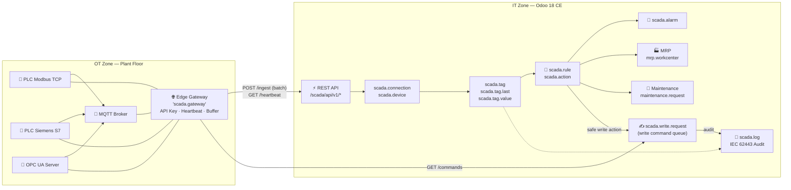
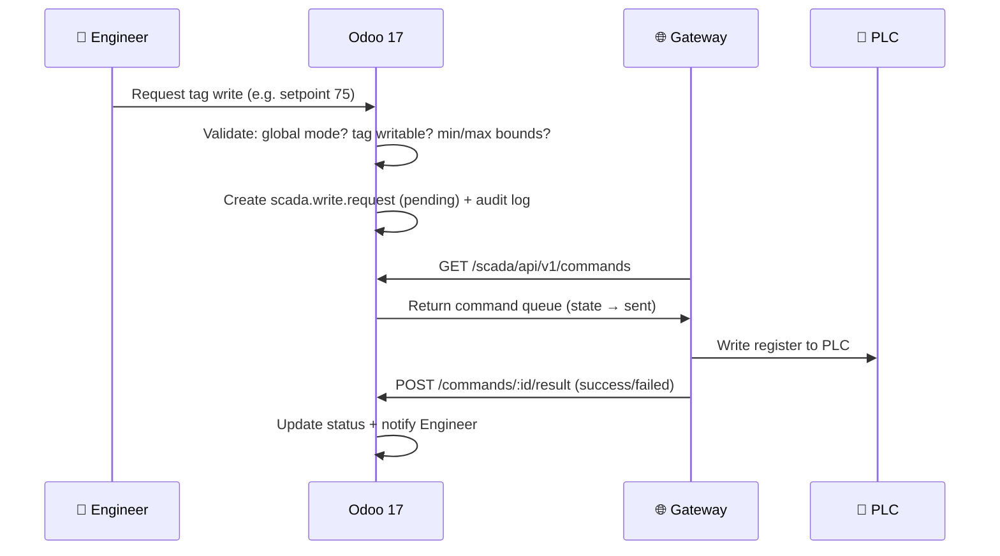

<div align="center">

# ⚡ SCADA PLC Connector

### Industrial Machine Integration, PLC & Real-time Telemetry Platform for Odoo 18 CE


**Turn Odoo 17 Community Edition into your factory's SCADA control center — without writing code.**

[🚀 Quick Start](#-quick-start) · [🔌 Protocols](#-protocol-support) · [🏗️ Architecture](#-architecture) · [📡 REST API](#-rest-api-gateway) · [🔒 Security](#-security--iec-62443) · [🧱 Driver SDK](#-driver-sdk)

</div>

---

## 📑 Table of Contents

- [🎯 About This Module](#-about-this-module)
- [✨ Key Features](#-key-features)
- [🏗️ Architecture](#-architecture)
- [🔌 Protocol Support](#-protocol-support)
- [🧩 Data Models](#-data-models)
- [📡 REST API Gateway](#-rest-api-gateway)
- [🚀 Quick Start](#-quick-start)
- [🔐 Security & IEC 62443](#-security--iec-62443)
- [🧱 Driver SDK](#-driver-sdk)
- [🛣️ Roadmap](#️-roadmap)
- [📁 Module Structure](#-module-structure)

---

## 🎯 About This Module

This module turns Odoo 18 CE into a **full IIoT/SCADA platform**: configure connections to PLCs and gateways from the Odoo UI, pull real-time telemetry, run a rule engine with automatic alarms, and write values back to PLCs under industrial security controls.

> **Data flow**: PLC / Sensor → *Edge Gateway* (or Odoo worker) → Odoo REST API → Historian + Rule Engine → MRP, Maintenance, and Audit Log.

Two operating modes:

| Mode | How It Works | Best For |
|------|-------------|----------|
| 🌐 **Remote Edge Gateway** | A separate service polls the PLC and sends JSON batches to the Odoo REST API (SHA-256 API Key, heartbeat, store-and-forward buffer) | Multi-line plants, segregated OT/IT networks |
| 🖥️ **Embedded Odoo Worker** | Odoo polls the driver directly from the server (no external component needed) | Simple setups, MVP, development & testing |

---

## ✨ Key Features

| # | Feature | Details |
|---|---------|---------|
| 1 | **🔌 Protocol-Agnostic + Driver SDK** | Plugin drivers registered via a registry with a standard `connect / read / write / browse` interface. Add new protocols without touching core code. |
| 2 | **🌐 Gateway Management** | One-time-visible API Keys (stored as SHA-256 hash), heartbeat & Online/Offline/Degraded status, **store-and-forward** buffer for network outages, config hot-reload via **ETag** without restart. |
| 3 | **🏷️ Tag Management** | 8 data types (`bool`, `int16/32`, `uint16/32`, `float32/64`, `string`), `scale`/`offset`/`formula` (safe_eval) transformation, **periodic / on-change / deadband** recording strategies, per-tag history retention, bulk CSV import via wizard. |
| 4 | **🧠 Rule Engine & Alarms** | Threshold conditions (`>`, `<`, range, no-data), **minimum duration**, **hysteresis**, **debounce** anti-fluctuation, info/warning/critical severity, alarm lifecycle *active → acknowledged → cleared*. |
| 5 | **⚡ Automated Actions (No Code)** | Automatically create `maintenance.request`, send chatter/email notifications, write a value to another PLC tag, or call a Server Action. |
| 6 | **🔒 Safe Write Control (IEC 62443)** | Writable tag whitelist, per-tag min/max value bounds, **global Read-Only mode**, two-step approval for critical tags, **append-only audit log**. |
| 7 | **📊 Historian** | Last value + append-only history + hourly/daily aggregation (avg/min/max), `good/bad/uncertain` data quality, TimescaleDB-ready. |
| 8 | **📡 REST Ingest API** | High-throughput batch endpoint, dynamic config with ETag/304, write command queue with delivery confirmation. |
| 9 | **🧪 Built-in Simulator** | Realistic patterns (temperature, RPM, pressure, counter) — test the full pipeline **without a physical PLC**. |
| 10 | **👥 4-Level RBAC** | `Viewer → User → Engineer → Administrator` with per-model ACL. |

---

## 🏗️ Architecture



<details>
<summary><b>📐 PLC write flow diagram (click to expand)</b></summary>


</details>

---

## 🔌 Protocol Support

| Protocol | Status | Example Address | Notes |
|----------|--------|-----------------|-------|
| 🧪 Built-in Simulator | ✅ Active | `SIM:TEMP_01`, `SIM:RPM`, `SIM:COUNTER` | Sine/random/counter patterns — demo & testing |
| 📡 Modbus TCP | ✅ Active | `40001`, `00001` (coil), `30001` | Real socket connection, configurable byte/word order |
| 🔗 OPC UA | 🔜 Phase 2 | `ns=2;s=Line1.Furnace.Temp` | Driver registry ready, requires `opcua` library |
| 🟦 Siemens S7 | 🔜 Phase 2 | `DB1.DBD0`, `MW10`, `M0.0` | Rack/slot parameters available in the UI |
| 📨 MQTT / Sparkplug B | 🔜 Phase 2 | `factory/line1/machine2/telemetry/+#` | Per-connection topic prefix |

> All protocols appear automatically in the Odoo dropdown via the **Driver Registry** — see [Driver SDK](#-driver-sdk).

---

## 🧩 Data Models

| Model | Name | Purpose |
|-------|------|---------|
| `scada.gateway` | Edge Gateway | Gateway registration, API Key, heartbeat, buffer |
| `scada.connection` | PLC Connection | Protocol, host/port, timeout, retry, custom params |
| `scada.device` | Device / Machine | Links to `mrp.workcenter` & `maintenance.equipment` |
| `scada.tag` | Tag Definition | Address, data type, transformation, write rules |
| `scada.tag.last` | Last Value | 1-row cache per tag (unique constraint) |
| `scada.tag.value` | History | Append-only, source & receive timestamps |
| `scada.tag.aggregate` | Aggregation | Hourly/daily buckets: avg, min, max, count |
| `scada.rule` | Rule | Condition, threshold, duration, hysteresis, severity |
| `scada.action` | Action | Maintenance, notification, PLC write, server action |
| `scada.alarm` | Alarm | active → ack → cleared, duplicate-prevention |
| `scada.write.request` | Write Queue | Safe PLC commands with status & audit |
| `scada.mapping` | Mapping | Tag → Odoo field (e.g. `mrp.production.qty_producing`) |
| `scada.log` | Audit Log | Append-only categories: connection, telemetry, write_audit, security |

---

## 📡 REST API Gateway

All endpoints are prefixed with `/scada/api/v1/` and require the `Authorization: Bearer <API_KEY>` header.

| Method | Endpoint | Purpose |
|--------|----------|---------|
| `POST` | `/heartbeat` | Gateway heartbeat + buffer status update |
| `GET` | `/config` | Fetch connection & tag configuration (**ETag** → `304 Not Modified`) |
| `POST` | `/ingest` | Receive batch tag readings → historian + rule evaluation |
| `POST` | `/commands` | Gateway fetches pending write command queue |
| `POST` | `/commands/:id/result` | Confirm PLC write execution result |

### Usage Examples

```bash
# 1️⃣ Fetch configuration (dynamic, no gateway restart needed)
curl -H "Authorization: Bearer scada_gw_xxxxx" \
     https://odoo-factory.example.com/scada/api/v1/config

# 2️⃣ Send a telemetry batch (1000 tags/second OK)
curl -X POST https://odoo-factory.example.com/scada/api/v1/ingest \
     -H "Authorization: Bearer scada_gw_xxxxx" \
     -H "Content-Type: application/json" \
     -d '{
       "readings": [
         {"tag_code": "SPINDLE_TEMP", "value": 82.4, "quality": "good", "timestamp": "2026-10-18T08:00:00"},
         {"tag_code": "LINE_RPM",     "value": 1450, "quality": "good"}
       ]
     }'
# → {"status": "ok", "processed": 2}

# 3️⃣ Heartbeat
curl -X POST https://odoo-factory.example.com/scada/api/v1/heartbeat \
     -H "Authorization: Bearer scada_gw_xxxxx" \
     -d '{"version": "1.0.0", "host_os": "Debian 12", "buffer_size": 0}'

# 4️⃣ Fetch pending write commands
curl -X POST https://odoo-factory.example.com/scada/api/v1/commands \
     -H "Authorization: Bearer scada_gw_xxxxx"
```

> **Note:** `type='json'` routes require a JSON-RPC envelope: `{"jsonrpc":"2.0","method":"call","params":{…},"id":null}`. See [AGENTS.md](../../../../AGENTS.md) for known API bugs and workarounds.

---

## 🚀 Quick Start

### 1. Installation

```bash
# Copy the module to your addons path
cp -r scada_plc_connector /path/to/odoo/addons/

# Or configure addons_path in odoo.conf
addons_path = /path/to/odoo/addons,/path/to/custom_addons
```

Then from the Odoo UI: **Apps → search "SCADA PLC Connector" → Install**.

### 2. Create a Gateway & API Key

1. Go to **SCADA & PLC → Configuration → Edge Gateways → New**
2. Fill in the name, select the operating mode, then click **Generate / Rotate API Key**
3. ⚠️ **Copy the API Key now** — it is only displayed once (stored as a SHA-256 hash)

### 3. Simulator Connection (No Physical PLC Required)

1. **Configuration → PLC Connections → New**
2. Select protocol **Built-in PLC Simulator**, set any host, click **Test Connection** ✅
3. Create tags, for example:

| Code | Address | Type | Unit |
|------|---------|------|------|
| `SPINDLE_TEMP` | `SIM:TEMP_01` | float32 | °C |
| `LINE_RPM` | `SIM:RPM` | float32 | RPM |
| `PROD_COUNT` | `SIM:COUNTER` | int32 | pcs |

### 4. End-to-End Test

```bash
# Read a tag value directly from the tag form → click "Read Now"
# Or push a value via API:
curl -X POST http://localhost:8069/scada/api/v1/ingest \
     -H "Authorization: Bearer <YOUR_API_KEY>" \
     -H "Content-Type: application/json" \
     -d '{"readings": [{"tag_code": "SPINDLE_TEMP", "value": 86.5}]}'
```

### 5. Set Up an Alarm Rule

Create rule **"Spindle Overheat Detection"**:
- Tag: `SPINDLE_TEMP` · Condition: `>` · Threshold: `85` · Duration: `30 seconds` · Hysteresis: `2 °C` · Severity: **Critical**
- Action: **Create Maintenance Request** → a ticket appears automatically in the Maintenance menu when the temperature spikes 🎉

<details>
<summary>Sample CSV for bulk tag import (wizard)</summary>

```csv
code,name,address,data_type,unit
SPINDLE_TEMP,Main Spindle Motor Temperature,SIM:TEMP_01,float32,°C
LINE_RPM,Spindle Rotational Speed,SIM:RPM,float32,RPM
PROD_COUNT,Finished Product Counter,SIM:COUNTER,int32,pcs
HYD_PRESS,Hydraulic Pressure,SIM:PRESS_01,float32,bar
RUN_STATUS,Machine Running Status,SIM:STATUS,bool,
```

</details>

---

## 🔐 Security & IEC 62443

<details open>
<summary><b>PLC write defense layers (click for full details)</b></summary>

| Layer | Mechanism |
|-------|-----------|
| 1️⃣ **Global Read-Only Mode** | `scada.readonly_mode` parameter — a single switch disables ALL PLC writes |
| 2️⃣ **Tag Whitelist** | Only tags with `is_writable = True` may be written; all tags default to Read-Only |
| 3️⃣ **Safe Value Bounds** | `min_write_value` / `max_write_value` validation per tag — values outside the range are **rejected** |
| 4️⃣ **Two-Step Approval** | `require_two_step_approval` flag for critical tags (process setpoints, safety interlocks) |
| 5️⃣ **RBAC** | Write operations restricted to **SCADA Engineer / Admin** groups; Viewer & User are read-only |
| 6️⃣ **Append-Only Audit Log** | Every write command is logged: who, what value, from where, when — immutable |

**Gateway Authentication**: API Keys are generated randomly (`secrets.token_urlsafe(32)`) and stored only as a **SHA-256 hash** — a database leak does not expose gateway access.

**Input Safety**: All tag formulas use `odoo.tools.safe_eval` (not raw `eval`), and ingest payloads are validated against the tag registry scoped to each gateway.

</details>

---

## 🧱 Driver SDK

Adding a new protocol is this simple — register the class and it automatically appears in the Odoo UI:

```python
from .scada_drivers import ScadaBaseDriver, ScadaDriverRegistry, Reading, WriteResult

@ScadaDriverRegistry.register
class ProfinetDriver(ScadaBaseDriver):
    protocol = 'profinet'                        # unique protocol code
    label = 'PROFINET / Siemens'                 # dropdown display label
    address_hint = 'I0.0, Q0.1, DB2.DBX4.0'     # address format hint shown in UI
    config_schema = {                             # dynamic connection parameters
        'rack': {'type': 'int', 'default': 0, 'label': 'Rack'},
    }

    def connect(self):
        # open a real connection to the device
        return True, "Connected to PROFINET device"

    def read(self, tags) -> dict:
        # {tag.code: Reading(value, quality, timestamp)}
        return {t.code: Reading(0.0, 'good', datetime.now()) for t in tags}

    def write(self, tag, value) -> WriteResult:
        return WriteResult(True, "OK", datetime.now())
```

Done — without changing a single line in `models/` or `controllers/`.

---

## 🛣️ Roadmap

| Phase | Item | Status |
|-------|------|--------|
| **1 (MVP)** | Simulator + Modbus TCP, gateway/heartbeat/buffer, tags & historian, rule engine, safe writes, REST API, RBAC | ✅ Done |
| **2** | OPC UA / S7 / MQTT live drivers, OWL live dashboard (bus.bus), trend charts, automatic aggregation | 🔜 |
| **3** | Docker image & systemd service for gateway (FR-G6), tag browser discovery, TimescaleDB hypertable | 🔜 |
| **4** | OEE/downtime reports, derived tags, shift-based rule scheduling, external webhooks | 🔜 |

<details>
<summary>📋 Full requirements (PRD) stored in <code>docs/prd/</code> — 9 sections, FR-G/C/D/T/S/R/A/V</summary>

The PRD covers 60+ functional requirements prioritized P0–P2, NFR targets (throughput ≥ 1000 tags/second, ingest latency < 200 ms), and store-and-forward resilience principles.

</details>

---

## 📁 Module Structure

```
scada_plc_connector/
├── __manifest__.py            # Module metadata (v17.0.1.0.0, LGPL-3)
├── models/
│   ├── models.py              # 13 core SCADA models
│   ├── scada_drivers.py       # Driver registry + built-in drivers
│   └── res_config_settings.py # Feature toggles (global read-only mode)
├── controllers/
│   └── controllers.py         # REST API /scada/api/v1/*
├── views/                     # Tree/form/search/kanban views + menus
├── security/                  # 4 RBAC groups + per-model ACL
├── data/                      # Demo data (gateway, connection, tags, rules)
├── wizard/
│   └── scada_wizards.py       # CSV tag import + PLC write wizard
├── static/description/        # Icon, banner, HTML description page
└── docs/prd/                  # Full PRD (not included in release)
```

---

<div align="center">

**📦 Install via Apps menu** · **[🔗 REST API](#-rest-api-gateway)** · **[🧪 Start without a PLC](#-quick-start)**

Made with ❤️ for the Odoo community · [NIITS](https://www.niits.id) · Author: **Arif N Ramadhan**


</div>
