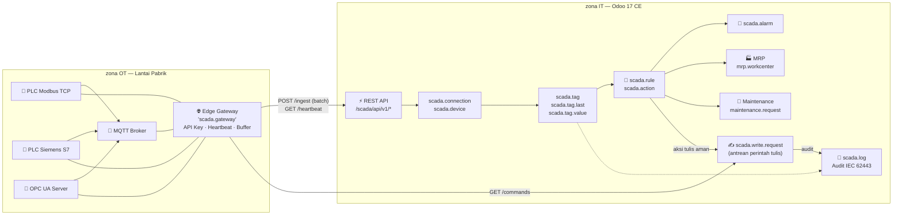
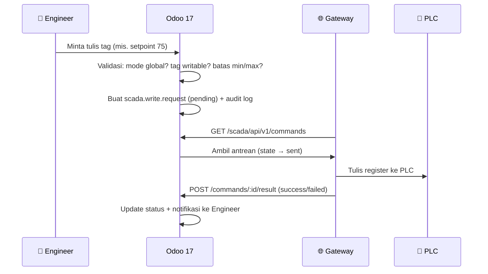

<div align="center">

# ⚡ SCADA PLC Connector

### Platform Integrasi Mesin Industri, PLC & Telemetri Real-time untuk Odoo 17 CE


**Jadikan Odoo 17 Community Edition sebagai pusat kendali SCADA pabrik Anda — tanpa coding.**

[🚀 Quick Start](#-quick-start) · [🔌 Protokol](#-dukungan-protokol) · [🏗️ Arsitektur](#-arsitektur) · [📡 REST API](#-rest-api-gateway) · [🔒 Keamanan](#-keamanan--iec-62443) · [🌐 English](#-english-overview)

</div>

---

## 📑 Daftar Isi

- [🎯 Tentang Modul Ini](#-tentang-modul-ini)
- [✨ Fitur Utama](#-fitur-utama)
- [🏗️ Arsitektur](#-arsitektur)
- [🔌 Dukungan Protokol](#-dukungan-protokol)
- [🧩 Model Data](#-model-data)
- [📡 REST API Gateway](#-rest-api-gateway)
- [🚀 Quick Start](#-quick-start)
- [🔐 Keamanan & IEC 62443](#-keamanan--iec-62443)
- [🧱 Driver SDK](#-driver-sdk)
- [🛣️ Roadmap](%EF%B8%8F-roadmap)
- [📁 Struktur Modul](#-struktur-modul)
- [🌐 English Overview](#-english-overview)

---

## 🎯 Tentang Modul Ini

Modul ini mengubah Odoo 17 CE menjadi **platform IIoT/SCADA penuh**: mengonfigurasi koneksi ke PLC dan gateway dari UI Odoo, menarik telemetri real-time, menjalankan rule engine & alarm otomatis, hingga menuliskan kembali nilai ke PLC dengan kontrol keamanan industri.

> **Data mengalir**: PLC / Sensor → *Edge Gateway* (atau worker Odoo) → REST API Odoo → Historian + Rule Engine → MRP, Maintenance, dan Audit Log.

Dua mode operasi:

| Mode | Cara Kerja | Cocok Untuk |
|------|-----------|-------------|
| 🌐 **Remote Edge Gateway** | Service terpisah menabrak PLC lalu kirim batch JSON ke REST API Odoo (API Key SHA-256, heartbeat, store-and-forward buffer) | Pabrik dengan banyak lini, jaringan terpisah OT/IT |
| 🖥️ **Embedded Odoo Worker** | Odoo polling driver langsung dari server (tanpa komponen eksternal) | Instalasi sederhana, MVP, testing |

---

## ✨ Fitur Utama

| # | Fitur | Detail |
|---|-------|--------|
| 1 | **🔌 Protocol-Agnostic + Driver SDK** | Driver plugin terdaftar via registry dengan interface standar `connect / read / write / browse`. Tambah protokol baru tanpa menyentuh kode inti. |
| 2 | **🌐 Gateway Management** | API Key sekali-tampil (disimpan sebagai hash SHA-256), heartbeat & status Online/Offline/Degraded, buffer **store-and-forward** saat koneksi terputus, update konfigurasi via **ETag** tanpa restart. |
| 3 | **🏷️ Manajemen Tag** | 8 tipe data (`bool`, `int16/32`, `uint16/32`, `float32/64`, `string`), transformasi `scale`/`offset`/`formula` (safe_eval), strategi rekam **periodic / on-change / deadband**, retensi histori per tag, import CSV massal via wizard. |
| 4 | **🧠 Rule Engine & Alarm** | Kondisi ambang (`>`, `<`, range, no-data), **durasi minimum**, **histeresis**, **debounce** anti-fluktuasi, severity info/warning/critical, siklus alarm *active → acknowledged → cleared*. |
| 5 | **⚡ Aksi Otomatis Tanpa Coding** | Otomatis buat `maintenance.request`, kirim notifikasi chatter/email, tulis nilai ke tag PLC lain, atau panggil Server Action. |
| 6 | **🔒 Kontrol Tulis Aman (IEC 62443)** | Whitelist tag writable, batas nilai min/max per tag, **mode Read-Only global**, persetujuan 2 langkah untuk tag kritis, **audit log append-only**. |
| 7 | **📊 Historian** | Nilai terakhir + histori append-only + agregasi jam/hari (avg/min/max), kualitas data `good/bad/uncertain`, siap TimescaleDB. |
| 8 | **📡 REST API Ingest** | Endpoint batch berkecepatan tinggi, konfigurasi dinamis dengan ETag/304, antrean perintah tulis dengan konfirmasi hasil. |
| 9 | **🧪 Simulator Bawaan** | Pola realistis (suhu, RPM, tekanan, counter) — uji seluruh alur **tanpa PLC fisik**. |
| 10 | **👥 RBAC 4 Level** | `Viewer → User → Engineer → Administrator` dengan ACL per model. |

---

## 🏗️ Arsitektur



<details>
<summary><b>📐 Diagram alur penulisan ke PLC (klik untuk buka)</b></summary>


</details>

---

## 🔌 Dukungan Protokol

| Protokol | Status | Contoh Alamat | Catatan |
|----------|--------|---------------|---------|
| 🧪 Built-in Simulator | ✅ Aktif | `SIM:TEMP_01`, `SIM:RPM`, `SIM:COUNTER` | Pola sinus/acak/counter — demo & testing |
| 📡 Modbus TCP | ✅ Aktif | `40001`, `00001` (coil), `30001` | Koneksi socket nyata, byte/word order dapat diatur |
| 🔗 OPC UA | 🔜 Fase 2 | `ns=2;s=Line1.Furnace.Temp` | Registry driver siap, perlu library `opcua` |
| 🟦 Siemens S7 | 🔜 Fase 2 | `DB1.DBD0`, `MW10`, `M0.0` | Parameter rack/slot tersedia di UI |
| 📨 MQTT / Sparkplug B | 🔜 Fase 2 | `factory/line1/machine2/telemetry/+#` | Topic prefix per koneksi |

> Semua protokol muncul otomatis di dropdown Odoo berdasarkan **Driver Registry** — lihat [Driver SDK](#-driver-sdk).

---

## 🧩 Model Data

| Model | Nama | Fungsi |
|-------|------|--------|
| `scada.gateway` | Edge Gateway | Registrasi gateway, API Key, heartbeat, buffer |
| `scada.connection` | Koneksi PLC | Protokol, host/port, timeout, retry, parameter khusus |
| `scada.device` | Perangkat/Mesin | Relasi ke `mrp.workcenter` & `maintenance.equipment` |
| `scada.tag` | Definisi Tag | Alamat, tipe data, transformasi, aturan penulisan |
| `scada.tag.last` | Nilai Terakhir | Cache 1 baris per tag (unique constraint) |
| `scada.tag.value` | Histori | Append-only, timestamp sumber & penerima |
| `scada.tag.aggregate` | Agregasi | Bucket per jam/hari: avg, min, max, count |
| `scada.rule` | Aturan | Kondisi, ambang, durasi, histeresis, severity |
| `scada.action` | Aksi | Maintenance, notifikasi, tulis PLC, server action |
| `scada.alarm` | Alarm | active → ack → cleared, anti-duplikat |
| `scada.write.request` | Antrean Tulis | Perintah aman ke PLC dengan status & audit |
| `scada.mapping` | Pemetaan | Tag → field Odoo (mis. `mrp.production.qty_producing`) |
| `scada.log` | Audit Log | Append-only kategori: connection, telemetry, write_audit, security |

---

## 📡 REST API Gateway

Semua endpoint diawali `/scada/api/v1/` dan memerlukan header `Authorization: Bearer <API_KEY>`.

| Method | Endpoint | Fungsi |
|--------|----------|--------|
| `POST` | `/heartbeat` | Detak jantung gateway + status buffer |
| `GET` | `/config` | Ambil konfigurasi koneksi & tag (**ETag** → `304 Not Modified`) |
| `POST` | `/ingest` | Terima batch pembacaan tag → histori + evaluasi rule |
| `POST` | `/commands` | Gateway mengambil antrean perintah tulis |
| `POST` | `/commands/:id/result` | Konfirmasi hasil eksekusi tulis ke PLC |

### Contoh penggunaan

```bash
# 1️⃣ Ambil konfigurasi (dinamis, tanpa restart gateway)
curl -H "Authorization: Bearer scada_gw_xxxxx" \
     https://odoo-pabrik.example.com/scada/api/v1/config

# 2️⃣ Kirim batch telemetri (1000 tag/detik OK)
curl -X POST https://odoo-pabrik.example.com/scada/api/v1/ingest \
     -H "Authorization: Bearer scada_gw_xxxxx" \
     -H "Content-Type: application/json" \
     -d '{
       "readings": [
         {"tag_code": "SPINDLE_TEMP", "value": 82.4, "quality": "good", "timestamp": "2026-10-18T08:00:00"},
         {"tag_code": "LINE_RPM",     "value": 1450, "quality": "good"}
       ]
     }'
# → {"status": "ok", "processed": 2}

# 3️⃣ Heartbeat
curl -X POST https://odoo-pabrik.example.com/scada/api/v1/heartbeat \
     -H "Authorization: Bearer scada_gw_xxxxx" \
     -d '{"version": "1.0.0", "host_os": "Debian 12", "buffer_size": 0}'

# 4️⃣ Ambil antrean perintah tulis
curl -X POST https://odoo-pabrik.example.com/scada/api/v1/commands \
     -H "Authorization: Bearer scada_gw_xxxxx"
```

---

## 🚀 Quick Start

### 1. Instalasi

```bash
# Salin modul ke addons path Anda
cp -r scada_plc_connector /path/to/odoo/addons/

# Atau gunakan addons_path di odoo.conf
addons_path = /path/to/odoo/addons,/path/to/custom_addons
```

Lalu dari UI Odoo: **Apps → cari "SCADA PLC Connector" → Install**.

### 2. Buat Gateway & API Key

1. Menu **SCADA & PLC → Konfigurasi → Edge Gateways → Baru**
2. Isi nama, pilih mode operasi, klik **Generate API Key**
3. ⚠️ **Salin API Key sekarang** — hanya ditampilkan sekali (disimpan sebagai hash SHA-256)

### 3. Koneksi Simulator (tanpa PLC fisik)

1. **Konfigurasi → Koneksi PLC → Baru**
2. Pilih protokol **Built-in PLC Simulator**, isi host bebas, klik **Test Connection** ✅
3. Buat tag, misalnya:

| Kode | Alamat | Tipe | Unit |
|------|--------|------|------|
| `SPINDLE_TEMP` | `SIM:TEMP_01` | float32 | °C |
| `LINE_RPM` | `SIM:RPM` | float32 | RPM |
| `PROD_COUNT` | `SIM:COUNTER` | int32 | pcs |

### 4. Uji End-to-End

```bash
# Baca nilai tag langsung dari form tag → tombol "Read Now"
# Atau kirim via API:
curl -X POST http://localhost:8069/scada/api/v1/ingest \
     -H "Authorization: Bearer <API_KEY_ANDA>" \
     -H "Content-Type: application/json" \
     -d '{"readings": [{"tag_code": "SPINDLE_TEMP", "value": 86.5}]}'
```

### 5. Pasang Rule Alarm

Buat rule **"Deteksi Overheat Spindle"**:
- Tag: `SPINDLE_TEMP` · Kondisi: `>` · Ambang: `85` · Durasi: `30 detik` · Histeresis: `2 °C` · Severity: **Critical**
- Aksi: **Buat Maintenance Request** → tiket otomatis muncul di menu Maintenance saat suhu meledak 🎉

<details>
<summary>Contoh CSV untuk import tag massal (wizard)</summary>

```csv
code,name,address,data_type,unit
SPINDLE_TEMP,Suhu Spindle Motor Utama,SIM:TEMP_01,float32,°C
LINE_RPM,Kecepatan Putaran Spindle,SIM:RPM,float32,RPM
PROD_COUNT,Counter Produk Jadi,SIM:COUNTER,int32,pcs
HYD_PRESS,Tekanan Hidrolik,SIM:PRESS_01,float32,bar
RUN_STATUS,Status Mesin Running,SIM:STATUS,bool,
```

</details>

---

## 🔐 Keamanan & IEC 62443

<details open>
<summary><b>Lapisan pertahanan penulisan ke PLC (klik detail lengkap)</b></summary>

| Lapisan | Mekanisme |
|---------|-----------|
| 1️⃣ **Mode Read-Only Global** | Parameter `scada.readonly_mode` — satu sakelar mematikan SEMUA penulisan ke PLC |
| 2️⃣ **Whitelist Tag** | Hanya tag dengan `is_writable = True` yang boleh ditulis; default semua Read-Only |
| 3️⃣ **Batas Nilai Aman** | Validasi `min_write_value` / `max_write_value` per tag — nilai di luar rentang **ditolak** |
| 4️⃣ **Persetujuan 2 Langkah** | Flag `require_two_step_approval` untuk tag kritis (setpoint proses, safety) |
| 5️⃣ **RBAC** | Penulisan hanya untuk grup **SCADA Engineer/Admin**; Viewer & User hanya baca |
| 6️⃣ **Audit Log Append-Only** | Setiap perintah tulis dicatat: siapa, nilai apa, dari mana, kapan — tak dapat diubah |

**Otentikasi Gateway**: API Key di-generate acak (`secrets.token_urlsafe(32)`), disimpan hanya sebagai **SHA-256 hash** — kebocoran database tidak memberi akses ke gateway.

**Keamanan input**: seluruh formula tag menggunakan `odoo.tools.safe_eval` (bukan `eval` mentah), dan payload ingest divalidasi terhadap registry tag per gateway.

</details>

---

## 🧱 Driver SDK

Menambah protokol baru semudah ini — daftarkan kelasnya, dan ia otomatis muncul di UI Odoo:

```python
from .scada_drivers import ScadaBaseDriver, ScadaDriverRegistry, Reading, WriteResult

@ScadaDriverRegistry.register
class ProfinetDriver(ScadaBaseDriver):
    protocol = 'profinet'                       # kode unik
    label = 'PROFINET / Siemens'                # tampilan di dropdown
    address_hint = 'I0.0, Q0.1, DB2.DBX4.0'     # bantuan format alamat
    config_schema = {                            # parameter koneksi dinamis
        'rack': {'type': 'int', 'default': 0, 'label': 'Rack'},
    }

    def connect(self):
        # buka koneksi nyata ke perangkat
        return True, "Connected to PROFINET device"

    def read(self, tags) -> dict:
        # {tag.code: Reading(value, quality, timestamp)}
        return {t.code: Reading(0.0, 'good', datetime.now()) for t in tags}

    def write(self, tag, value) -> WriteResult:
        return WriteResult(True, "OK", datetime.now())
```

Selesai — tanpa mengubah satu baris pun di `models/` atau `controllers/`.

---

## 🛣️ Roadmap

| Fase | Item | Status |
|------|------|--------|
| **1 (MVP)** | Simulator + Modbus TCP, gateway/heartbeat/buffer, tag & histori, rule engine, write aman, REST API, RBAC | ✅ Selesai |
| **2** | Driver OPC UA / S7 / MQTT nyata, dashboard OWL live (bus.bus), grafik tren, agregasi otomatis | 🔜 |
| **3** | Docker image & systemd service untuk gateway (FR-G6), tag browser discovery, TimescaleDB hypertable | 🔜 |
| **4** | Laporan OEE/downtime, tag turunan, jadwal aktif rule per shift, webhook eksternal | 🔜 |

<details>
<summary>📋 Kebutuhan lengkap (PRD) tersimpan di <code>docs/prd/</code> — 9 bagian, FR-G/C/D/T/S/R/A/V</summary>

PRD mencakup 60+ persyaratan fungsional terprioritas P0–P2, target NFR (throughput ≥ 1000 tag/detik, latensi ingest < 200 ms), dan prinsip ketahanan store-and-forward.

</details>

---

## 📁 Struktur Modul

```
scada_plc_connector/
├── __manifest__.py            # Metadata modul (v17.0.1.0.0, LGPL-3)
├── models/
│   ├── models.py              # 13 model inti SCADA
│   ├── scada_drivers.py       # Driver registry + driver bawaan
│   └── res_config_settings.py # Fitur toggle (mode read-only global)
├── controllers/
│   └── controllers.py         # REST API /scada/api/v1/*
├── views/                     # Tree/form/search/kanban + menu
├── security/                  # 4 grup RBAC + ACL per model
├── data/                      # Data demo (gateway, koneksi, tag, rule)
├── wizard/
│   └── scada_wizards.py       # Import tag CSV + tulis nilai
├── static/description/        # Icon, banner, halaman deskripsi HTML
└── docs/prd/                  # PRD lengkap (tidak ikut publikasi)
```

---

## 🌐 English Overview

**SCADA PLC Connector** turns **Odoo 17 Community Edition** into a full IIoT/SCADA platform — configure industrial PLC connections from the Odoo UI, stream real-time telemetry, run threshold rules with automatic maintenance requests, and write values back to PLCs under strict IEC 62443-style safeguards.

**Highlights**

- **Protocol-agnostic driver SDK** — built-in Simulator & Modbus TCP today; OPC UA, Siemens S7, MQTT/Sparkplug B registered for phase 2. Add your own driver in ~30 lines.
- **Edge Gateway management** — one-time-visible API keys (SHA-256 hashed), heartbeat & online/offline status, store-and-forward buffer, hot config reload via ETag.
- **Tag engine** — 8 data types, scale/offset/custom formula (`safe_eval`), periodic/on-change/deadband recording strategies, CSV bulk import.
- **Rule engine & alarms** — thresholds with minimum duration, hysteresis and debounce; alarm lifecycle *active → acknowledged → cleared*; chained actions (maintenance ticket, chatter/email notification, write to PLC, server action).
- **Safe writes** — global read-only switch, per-tag whitelist & min/max bounds, optional two-step approval, append-only audit log.
- **High-throughput REST ingest** — batch endpoint `/scada/api/v1/ingest`, dynamic config with ETag caching, command queue with delivery confirmation.
- **Built-in simulator** — validate the entire pipeline without any physical PLC.
- **4-level RBAC** — Viewer / User / Engineer / Administrator per model.

**Architecture**: `PLC → Edge Gateway (REST batch) → Odoo API → Historian + Rule Engine → MRP / Maintenance / Audit`.

<details>
<summary>🔌 Supported protocols</summary>

| Protocol | Status |
|----------|--------|
| Built-in PLC Simulator | ✅ |
| Modbus TCP / RTU | ✅ |
| OPC UA | 🔜 Phase 2 |
| Siemens S7 (Profinet) | 🔜 Phase 2 |
| MQTT / Sparkplug B | 🔜 Phase 2 |

</details>

---

<div align="center">

**📦 Install via Apps menu** · **[🔗 REST API](#-rest-api-gateway)** · **[🧪 Mulai tanpa PLC](#-quick-start)**

Made with ❤️ for the Odoo community · [NIITS](https://www.niits.id) · Author: **Arif N Ramadhan**


</div>
